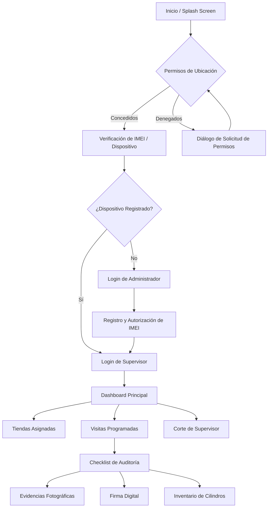

# 📱 Tropi Supervisores GT (`app_supervisores_gt`)

> Aplicación móvil oficial para supervisores y encargados de operaciones de **Tropigas Guatemala (Grupo Tomza)**. Desarrollada en **Flutter** para optimizar la gestión de puntos de venta, control de inventario, auditoría de visitas en tienda, corte de rutas (preventa), captura de evidencias fotográficas y firmas de conformidad.

---

## 📑 Tabla de Contenidos

1. [Visión General](#-visión-general)
2. [Stack Tecnológico y Requisitos](#-stack-tecnológico-y-requisitos)
3. [Prerrequisitos de Desarrollo](#-prerrequisitos-de-desarrollo)
4. [Instalación y Configuración Inicial](#-instalación-y-configuración-inicial)
5. [Variables de Entorno y Sabores (Flavors)](#-variables-de-entorno-y-sabores-flavors)
6. [Cómo Ejecutar y Depurar la Aplicación](#-cómo-ejecutar-y-depurar-la-aplicación)
7. [Compilación y Empaquetado (Build & Release)](#-compilación-y-empaquetado-build--release)
8. [Arquitectura y Estructura del Proyecto](#-arquitectura-y-estructura-del-proyecto)
9. [Flujo de Autenticación y Ciclo Operativo](#-flujo-de-autenticación-y-ciclo-operativo)
10. [Linter, Guía de Estilo y Comandos Útiles](#-linter-guía-de-estilo-y-comandos-útiles)
11. [Solución de Problemas Frecuentes (FAQ)](#-solución-de-problemas-frecuentes-faq)

---

## 🎯 Visión General

La aplicación **Tropi Supervisores GT** permite al personal de supervisión en campo llevar a cabo las siguientes operaciones clave:

- 🛡️ **Validación de Dispositivos por IMEI/ID:** Control estricto de acceso por hardware autorizado ante el backend de Genesys.
- 📊 **Dashboard Ejecutivo y KPIs:** Monitoreo del avance de metas en cilindros, galones, franjas y ventas proyectadas mediante gráficos interactivos.
- 🏪 **Gestión de Tiendas Asignadas:** Consulta y filtrado de puntos de venta a cargo del supervisor.
- 📅 **Visitas Programadas:** Agenda de supervisión con georreferenciación GPS en tiempo real.
- 📝 **Checklist de Auditoría:** Formulario interactivo para evaluar estándares de operación y servicio en tienda.
- 📸 **Evidencias Fotográficas e Incidencias:** Captura con cámara o galería y registro de descripciones.
- ✍️ **Firma Digital de Conformidad:** Módulo de rúbrica táctil para el cierre formal de la auditoría.
- 📦 **Control de Inventario:** Conteo físico y conciliación de cilindros de gas GLP en tienda.
- ✂️ **Corte de Supervisor (Preventa):** Consulta y corte de liquidaciones de ruta.
- 🖨️ **Soporte de Impresión Térmica:** Integración con impresoras portátiles (Bixolon SPP-R310 y compatibles).

---

## 🛠️ Stack Tecnológico y Requisitos

| Componente | Versión / Especificación |
|---|---|
| **Flutter SDK** | `3.47.1` (Administrado con **FVM**) |
| **Dart SDK** | `^3.13.1` |
| **Java Development Kit (JDK)** | **JDK 21** (Requerido por Android Gradle Plugin y Kotlin) |
| **Android Compile SDK / Target SDK** | `compileSdk = 37` · `targetSdk = 34+` · `minSdk = 21` |
| **Gestión de Estado** | `Provider` (`ChangeNotifier`) |
| **Inyección de Dependencias** | `get_it` (Service Locator / Singleton registry) |
| **Librería Base Corporativa** | `tomza_kit` (Red, interceptores HTTP Dio, estilos de marca y GPS) |
| **Almacenamiento Local** | `shared_preferences` |
| **Gráficas y UI** | `syncfusion_flutter_charts`, `syncfusion_flutter_signaturepad`, `lottie`, `google_fonts` (Gabarito) |
| **Localización / GPS** | `geolocator`, `tomza_kit/core/location` |

---

## 📋 Prerrequisitos de Desarrollo

Antes de comenzar, asegúrate de contar con lo siguiente en tu máquina de desarrollo:

### 1. Acceso a Git y Repositorios Privados
El proyecto consume la dependencia corporativa `tomza_kit` vía Git:
```yaml
tomza_kit:
  git:
    url: https://github.com/Jorge-Tropigas/tomza_kit/
    ref: main
```
> ⚠️ **Importante:** Debes tener permisos de lectura en la organización `Jorge-Tropigas` de GitHub y tener tus credenciales (SSH Key o Git Credential Manager con Personal Access Token) configuradas en tu terminal para que `flutter pub get` pueda clonar el paquete.

### 2. Flutter Version Management (FVM)
El proyecto utiliza FVM para garantizar que todos los desarrolladores utilicen la misma versión de Flutter (`3.47.1`).
```bash
dart pub global activate fvm
```
Verifica que el directorio de binarios globales de Dart esté en tu variable de entorno `PATH`.

### 3. Java Development Kit (JDK 21)
El script de compilación de Android (`android/app/build.gradle.kts`) requiere **Java 21**:
```bash
java -version
# Debe indicar versión 21.x (OpenJDK, Corretto, Temurin o Android Studio jbr-21)
```

### 4. Android SDK y Herramientas
- Android Studio (versión Jellyfish / Koala o superior recomendada).
- Android SDK Platform **API 34 - 37**.
- Android SDK Build-Tools y Command-line Tools.

---

## 🚀 Instalación y Configuración Inicial

Sigue estos pasos en orden para poner en marcha el proyecto:

### Paso 1: Clonar el Repositorio
```bash
git clone <URL_DEL_REPOSITORIO>
cd app_supervisores_gt
```

### Paso 2: Configurar el SDK con FVM
Instala y activa la versión de Flutter requerida:
```bash
fvm install
fvm use 3.47.1
```

### Paso 3: Limpiar e Instalar Dependencias
```bash
fvm flutter clean
fvm flutter pub get
```

### Paso 4: Configurar el Editor (VS Code)
Si utilizas **Visual Studio Code**, el proyecto ya incluye `.vscode/settings.json` apuntando al SDK de FVM:
```json
{
  "dart.flutterSdkPath": ".fvm/versions/3.47.1"
}
```
Instala las extensiones recomendadas:
- **Flutter** (`Dart-Code.flutter`)
- **Dart** (`Dart-Code.dart-code`)

---

## 🌐 Variables de Entorno y Sabores (Flavors)

El proyecto cuenta con dos entornos totalmente separados mediante **Flavors** y archivos `.env`:

| Entorno / Flavor | Archivo | Nombre de la App |
|---|---|---|---|
| **`dev`** (Desarrollo / QA) | `.env.dev` | `Supervisores GT Dev` |
| **`prod`** (Producción) | `.env.prod` | `Supervisores GT` |

### Estructura de Variables de Entorno
Ejemplo de configuración en `.env.dev`:
```properties
APP_NAME=Supervisores GT Dev
API_URL_DEV=https://pruebasgenesys.tomzagroup.com/SupervisoresAPI/
DEBUG_MODE=true
FEATURE_FLAG=false
INSECURE_SSL=true
```

> 💡 **Nota:** La clase `EnvService` (`lib/core/service/env_service.dart`) carga automáticamente `.env.dev` o `.env.prod` según el flavor con el que se ejecuta la app.

---

## 💻 Cómo Ejecutar y Depurar la Aplicación

### Opción A: Desde Visual Studio Code (Recomendado)
Abre el panel de **Run & Debug** (`Ctrl + Shift + D` / `Cmd + Shift + D`) y selecciona una de las configuraciones ya creadas en `.vscode/launch.json`:
- **`Supervisores GT Dev`**: Inicia en modo Debug apuntando al entorno de desarrollo.
- **`Supervisores GT`**: Inicia apuntando al entorno de producción.

### Opción B: Desde la Terminal (FVM CLI)

#### Ejecutar en Entorno de Desarrollo (Dev):
```bash
fvm flutter run --flavor dev --dart-define=APP_ENV=development
```

#### Ejecutar en Entorno de Producción (Prod):
```bash
fvm flutter run --flavor prod --dart-define=APP_ENV=production
```

Si tienes varios dispositivos o emuladores conectados:
```bash
fvm flutter devices
fvm flutter run -d <DEVICE_ID> --flavor dev
```

---

## 📦 Compilación y Empaquetado (Build & Release)

### 1. Script Automatizado (Recomendado)
En la carpeta `scripts/` se encuentra `build_apk.ps1`. Este script:
1. Lee `pubspec.yaml` e incrementa automáticamente el `build number` (`version: 1.0.0+X`).
2. Compila el APK en modo release para el sabor seleccionado.

Ejecútalo desde PowerShell en la raíz del proyecto:

```powershell
# Compilar versión de Desarrollo
.\scripts\build_apk.ps1 -Flavor dev

# Compilar versión de Producción
.\scripts\build_apk.ps1 -Flavor prod
```

Los APKs generados se ubicarán en:
```
build/app/outputs/flutter-apk/app-<flavor>-release.apk
```

### 2. Compilación Manual con Flutter CLI
Si prefieres no usar el script:
```bash
# Para Dev
fvm flutter build apk --flavor dev --release

# Para Prod
fvm flutter build apk --flavor prod --release
```

---

## 🏗️ Arquitectura y Estructura del Proyecto

El proyecto sigue una arquitectura **Feature-First + Clean Architecture** orientada a la mantenibilidad y modularidad:

```
lib/
├── main.dart                       # Punto de entrada; detección de flavor y arranque de DI
├── core/                           # Servicios globales y transversales
│   ├── app/
│   │   └── app.dart                # MaterialApp, temas corporativos (M3, Gabarito) y Snackbars
│   ├── data/
│   │   ├── datasource.dart         # Implementación de peticiones HTTP al API
│   │   ├── repository.dart         # Repositorio central de datos y lógica de negocio
│   │   └── model/                  # DTOs de Request y Response
│   ├── global/
│   │   └── global_bloc.dart        # Estado global persistente (usuario logueado, GPS, mapas)
│   ├── routes/
│   │   ├── route_paths.dart        # Nombres de rutas declaradas
│   │   └── route_switch.dart       # Transiciones y generador dinámico de rutas
│   ├── service/
│   │   └── env_service.dart        # Carga de variables de entorno y normalización de URLs
│   └── storage/
│       └── shared_preferences_helper.dart  # Persistencia de credenciales, IMEI y caché
├── features/                       # Módulos funcionales de la aplicación
│   ├── auth/                       # Autenticación y validación de hardware
│   │   ├── begin/                  # Splash y solicitud inicial de permisos (GPS)
│   │   ├── check_imei/             # Verificación de autorización de dispositivo en el API
│   │   ├── imei/                   # Asignación / consulta manual de IMEI
│   │   ├── login_admin/            # Login administrativo para autorizar nuevos dispositivos
│   │   └── login_user/             # Login de supervisor con usuario y contraseña
│   ├── dashboard/                  # Panel principal, métricas operativas y gráficas de venta
│   ├── stores/                     # Lista y detalle de tiendas asignadas
│   ├── scheduled_visits/           # Agenda y detalle de visitas programadas en ruta
│   ├── checklist/                  # Auditoría de tienda y formularios de evaluación
│   ├── photo_descripcion/          # Módulo de evidencias fotográficas de incidencias
│   ├── signature/                  # Firma digital manuscrita de conformidad
│   ├── inventory/                  # Conteo y control de cilindros de gas en tienda
│   ├── supervisor_cut/             # Preventa y cortes de supervisor
│   ├── goal_sale_point/            # Metas comerciales por punto de venta
│   └── settings/                   # Acerca de la app, versión y diagnósticos
└── utils/                          # Inyección de dependencias y widgets compartidos
    ├── injection_container.dart    # Configuración de GetIt (Singletons, Repositorios)
    ├── widgets/                    # CustomAppBar, CustomBottomNavigator, CustomDrawer
    └── utils/                      # Placeholders de carga, tarjetas de diseño y utilidades
```

### Patrón por Módulo (`features/<nombre_modulo>/`)
Cada feature mantiene una separación clara de responsabilidades:
- `logic/`: Clases de lógica de presentación que extienden de `ChangeNotifier` (controladores / ViewModels).
- `model/`: Entidades y modelos de datos específicos de la funcionalidad.
- `page/` / `pages/`: Pantallas principales construidas con widgets de Flutter.
- `widgets/`: Componentes visuales y tarjetas reutilizables pertenecientes a la funcionalidad.

---

## 🔄 Flujo de Autenticación y Ciclo Operativo

Para comprender la navegación del usuario al iniciar la app:



1. **Splash:** Valida e inicializa los servicios de ubicación (GPS).
2. **Check IMEI:** Consulta el ID del dispositivo (Android ID o IMEI configurado) en el servidor. Si el teléfono no está autorizado, se redirige a `LoginAdmin` para que un administrador autorice el dispositivo en la base de datos de Tropigas.
3. **Login de Usuario:** El supervisor ingresa sus credenciales operativas.
4. **Dashboard:** Muestra el cumplimiento de cuotas y permite iniciar el flujo de supervisión en tienda.

---

## 📐 Linter, Guía de Estilo y Comandos Útiles

El proyecto mantiene convenciones estrictas de estilo definidas en `analysis_options.yaml` y `pubspec.yaml`:

- **Comillas simples:** Obligatorio el uso de comillas simples (`prefer_single_quotes: true`).
- **Imports absolutos con paquete:** Se debe usar `package:app_supervisores_gt/...` en lugar de rutas relativas largas (`always_use_package_imports: true`).

### Organización Automática de Imports (`tidy_imports`)
El proyecto está configurado para ordenar y clasificar automáticamente las importaciones (Dart, Flutter, paquetes de terceros, `tomza_kit` y paquetes internos):
```bash
fvm dart run tidy_imports
```

### Análisis Estático de Código
```bash
fvm flutter analyze
```

### Generación de Iconos de la Aplicación
Si se actualiza el logotipo o icono en `assets/images/`:
```bash
fvm flutter pub run flutter_launcher_icons
```

---

## ❓ Solución de Problemas Frecuentes (FAQ)

### 1. Error al ejecutar `fvm flutter pub get`: `Git error ... repository 'https://github.com/Jorge-Tropigas/tomza_kit/' not found`
- **Causa:** No tienes acceso al repositorio privado de `tomza_kit` o Git no está autenticado en tu consola.
- **Solución:**
  1. Verifica que tu usuario de GitHub tenga acceso al repositorio `Jorge-Tropigas/tomza_kit`.
  2. Si usas HTTPS, genera un Personal Access Token (PAT) con permisos de `repo` y configúralo en el Git Credential Manager de tu sistema.
  3. Si usas SSH, asegúrate de que tu clave esté añadida a tu agente SSH (`ssh-add ~/.ssh/id_ed25519`).

### 2. Error en compilación de Android: `sourceCompatibility JavaVersion.VERSION_21` o fallo de Gradle
- **Causa:** Tu entorno está ejecutando Gradle con un JDK inferior a Java 21 (por ejemplo, Java 11 o 17).
- **Solución:**
  1. Instala JDK 21.
  2. Configura la variable de entorno `JAVA_HOME` apuntando al directorio de JDK 21.
  3. En Android Studio, ve a **Settings > Build, Execution, Deployment > Build Tools > Gradle** y en **Gradle JDK** selecciona la versión 21.

### 3. VS Code no reconoce el SDK de Flutter o marca errores en paquetes
- **Causa:** VS Code está usando la instalación global de Flutter en lugar del SDK de FVM.
- **Solución:**
  1. Ejecuta `fvm use 3.47.1` en la raíz del proyecto.
  2. Presiona `Ctrl + Shift + P` en VS Code y escribe `Flutter: Change SDK`.
  3. Selecciona la ruta apuntada por `.fvm/versions/3.47.1`.
  4. Reinicia la ventana de VS Code (`Developer: Reload Window`).

### 4. La app se queda en el Splash o indica "Permisos necesarios"
- **Causa:** La app requiere permiso de ubicación para registrar coordenadas de supervisión.
- **Solución:**
  1. Si estás en emulador, asegúrate de que la ubicación virtual esté habilitada y configurada con coordenadas válidas.
  2. Concede los permisos de ubicación ("Mientras la app está en uso") desde la configuración del dispositivo.

### 5. Error "Dispositivo no registrado" al iniciar
- **Causa:** El ID o IMEI del emulador/dispositivo de pruebas no está dado de alta en la base de datos de pruebas.
- **Solución:**
  1. Presiona en continuar hacia el login de administrador.
  2. Ingresa con credenciales administrativas para asociar el dispositivo a un usuario de pruebas o contacta al administrador de la API de Genesys para autorizar tu Android ID.

---

**Tropigas de Guatemala S.A.** — *Departamento de Desarrollo Móvil*
